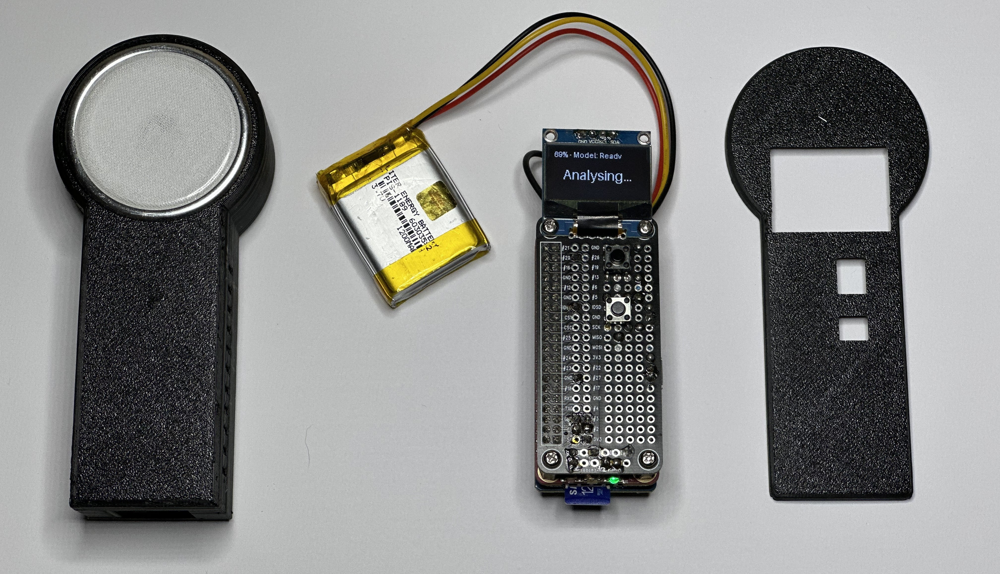

# Hardware prototype



Offline, battery-powered screening device: an Orange Pi Zero 2 W running the
ONNX models with ONNX Runtime, a USB microphone as the acquisition front end,
a 0.96" OLED for results and two push buttons for control, in a 3D-printed
PLA enclosure (paper Fig. 2).

## Compute target

| | |
| --- | --- |
| Board | Orange Pi Zero 2 W (Allwinner H618) |
| CPU | 4x ARM Cortex-A53 @ 1.5 GHz (no dot-product INT8 instructions, no FP16 arithmetic) |
| RAM | 4 GB DDR4 |
| Runtime | ONNX Runtime 1.24.2, 4 CPU threads, no PyTorch |

## Bill of materials (paper Table 1)

Single-unit retail prices converted to USD; multi-pack items charged per unit.

| Component | USD |
| --- | ---: |
| SBC (Allwinner H618, 4 GB) — Orange Pi Zero 2 W | 36 |
| Power-management HAT (PiJuice) | 43 |
| 1200 mAh Li-ion battery | 17 |
| 32 GB microSD card | 21 |
| 3D-printed PLA enclosure | 7 |
| USB microphone module | 11 |
| Aluminium heatsink | 9 |
| 0.96" OLED display | 4 |
| Prototyping HAT | 4 |
| Push buttons (x2) | 1 |
| **Indicative total** | **~153** |

## Software setup on the device

```bash
# on the Orange Pi (Python 3, aarch64)
pip install -r edge/requirements.txt

# copy the models from the release archive (see top-level README), then:
python3 edge/inference_edge.py --model exports/efficientnet_b0/model_int8_static.onnx --audio recording.wav
python3 edge/benchmark_orangepi.py --models_dir exports --input exports/bench_input.npy
```

Latency, size and memory numbers for every model and format are in
[`exports/orangepi_benchmark.json`](../exports/orangepi_benchmark.json)
(mean of 20 runs after 3 warm-ups, fixed input `bench_input.npy`).

## Limitation

The models are trained on CirCor DigiScope recordings (Littmann electronic
stethoscope). The low-cost USB microphone coupled to a stethoscope head introduces a domain shift that
is not evaluated in the paper; validate on device-acquired recordings before any
clinical use. This prototype is a research device, not a medical device.
